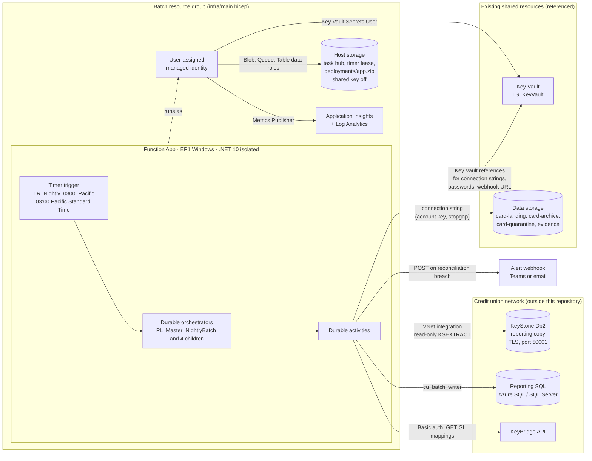
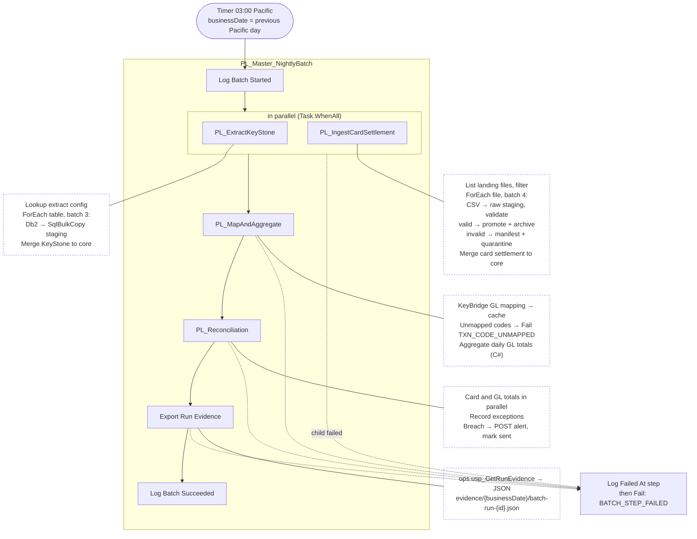
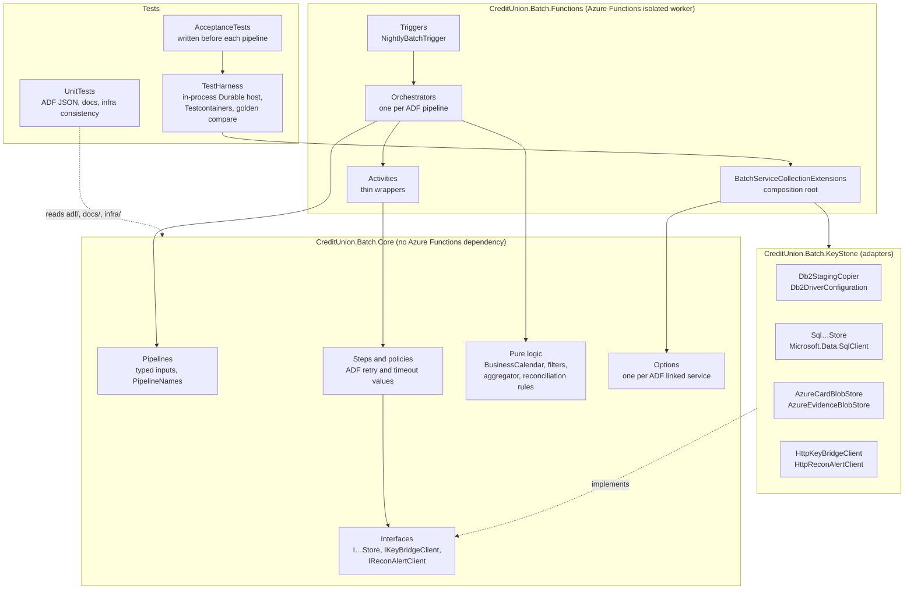

# Architecture

Three views of the same system:

1. [Azure deployment](#1-azure-deployment): the resources and connections, as [infra/main.bicep](../infra/main.bicep) describes them.
2. [Nightly batch flow](#2-nightly-batch-flow): how the orchestrators run.
3. [Code structure](#3-code-structure): the projects and how they depend on each other.

The Azure view is a design. It has **never been deployed** ([ADR 0020](decisions/0020-azure-hosting-plan-and-bicep-template.md)). Locally, Docker containers stand in for every Azure service ([table at the end](#local-stand-ins)).

## 1. Azure deployment

**What the arrows mean.**
- The **managed identity** reaches host storage, Key Vault and Application Insights. Nothing in that path uses a key.
- The **data storage account** is still reached with a connection string that contains the account key. That is a stopgap until the blob code uses the identity (ADR 0020).
- **Db2** needs the VNet integration subnet and TLS. Both are outside the template ([ADR 0019](decisions/0019-keystone-db2-secret.md)).

## 2. Nightly batch flow

Each ADF pipeline is an orchestrator with the same name. Each ADF activity that does I/O is a Durable activity ([ADR 0008](decisions/0008-acceptance-test-entry-points.md), [ADR 0014](decisions/0014-master-orchestration-and-failure-propagation.md)).

**Rules every step follows:**
- Every activity call has the ADF retry policy: retries + 1 attempts at a fixed interval ([ADR 0008](decisions/0008-acceptance-test-entry-points.md)).
- The ADF timeout is enforced for each attempt.
- Every pipeline logs its start and its outcome to `ops.BatchRun` in the reporting store.

## 3. Code structure

**Dependency direction.**
- `Core` depends on nothing in Azure Functions. The acceptance tests run the production composition root (`AddCreditUnionBatch`) inside the in-process harness ([ADR 0001](decisions/0001-hosting-model.md), [ADR 0008](decisions/0008-acceptance-test-entry-points.md)).
- Orchestrators do no I/O and read no clock ([ADR 0017](decisions/0017-orchestrator-determinism-check.md)).

## Local stand-ins

| Azure (diagram 1) | Local (`./build.ps1 up`, or Testcontainers in `./build.ps1 test`) |
| --- | --- |
| KeyStone Db2 | Db2 Community Edition container with the synthetic schema in `db/keystone-db2` |
| Reporting SQL | SQL Server 2022 Developer container with `db/reporting` |
| Host storage and data storage | Azurite |
| KeyBridge API and alert webhook | WireMock (`contracts/keybridge`) |
| Function App | Azure Functions Core Tools (`./build.ps1 run`) or the in-process test host |
| Key Vault | User-secrets and environment variables (`.env`) |
| Application Insights | Aspire dashboard container. OpenTelemetry export is not implemented yet, so it shows no batch traces. |
